<!-- The cards in assets/ are generated from the drivas.dev design: run `node scripts/build.mjs` after editing the copy in that script. -->

  <a href="https://www.linkedin.com/in/davidlrivas/"><picture><source media="(prefers-color-scheme: dark)" srcset="assets/social-linkedin-dark.svg"></picture></a>
  <a href="https://drivas.dev"><picture><source media="(prefers-color-scheme: dark)" srcset="assets/social-website-dark.svg"></picture></a>
  <a href="mailto:david.l.rivas@gmail.com"><picture><source media="(prefers-color-scheme: dark)" srcset="assets/social-email-dark.svg"></picture></a>

